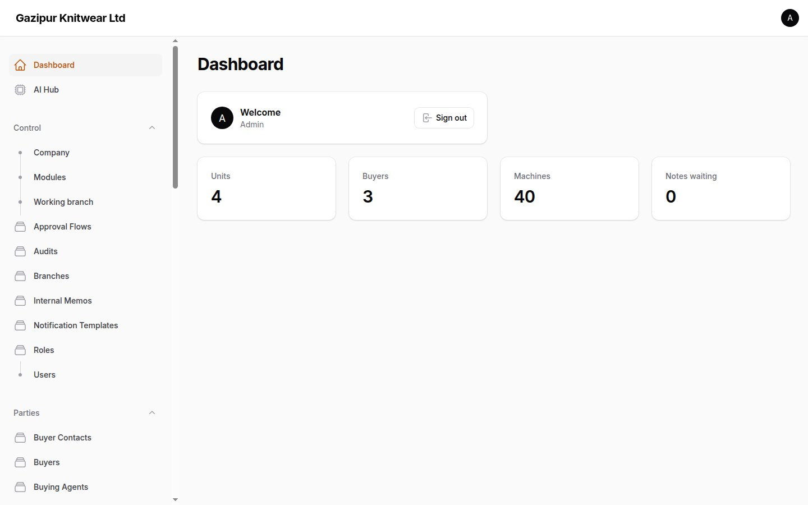
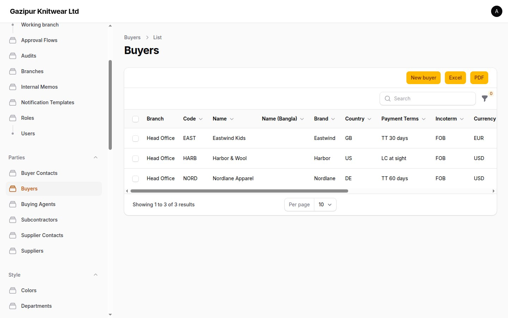
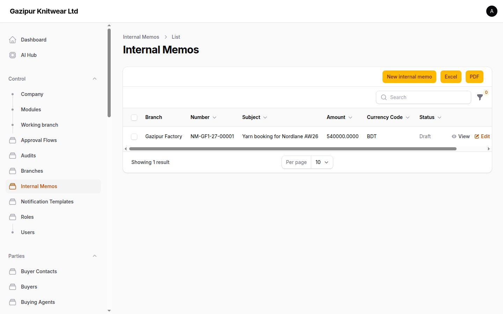
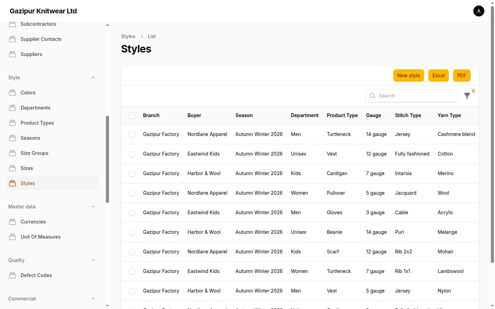
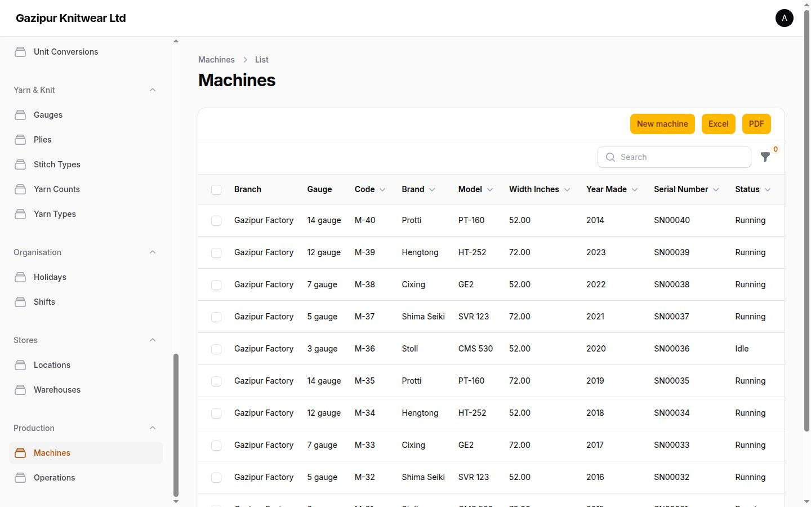

# Gazipur Knitwear

The factory system for a sweater mill. One company, several units, English and Bangla, and the note sheet the merchandising desk already walks upstairs for a signature.

**গাজীপুর নিটওয়্যার লিমিটেড** knits fully fashioned, jacquard and cut-and-sew sweaters. The public page is the front door. Staff, buyers, suppliers and sub-contractors each have their own.

<p>
  
</p>

## What a mill gets from this

A sweater factory already runs on lists: buyers, gauges, colours, machines, sizes, and a note that must be signed before yarn is booked. Those lists usually live in separate spreadsheets, and the note usually lives in a file. This system keeps them in one place, in the language the floor speaks, with the fiscal year the accounts desk already uses.

The demo mill has a head office, a knitting floor in Gazipur, a yarn store and a finishing unit. Sample buyers in the screenshots (Nordlane Apparel, Harbor & Wool, Eastwind Kids) are fictional, so the pictures can be shared.

<p>
  
  
</p>

## Where the day used to go

| The wait | What happens now |
|---|---|
| A note sheet in a file. A lost day when it sat on the wrong desk. | The same two signatures, merchandising manager then director, on the screen. After one working day the step is raised to the director. Both actions are stored. |
| A number written by hand. Two clerks can write the same one. | The number is taken under a lock the moment the draft exists. 16 November 2026 falls in fiscal year 2026-27, so the first Gazipur Factory note is `NM-GF1-27-00001`. |
| Gauge, colour, defect and machine lists in different spreadsheets. | One register each, with a Bangla name, and Excel or a Unicode PDF from that same list. |
| A buyer, a yarn supplier and a dye house sharing a staff password. | Each has a door: `/buyer`, `/supplier`, `/subcontractor`. |
| A knitting master opening head-office records. | The working branch limits the lists. Head office and each unit stay apart. |
| A Bangla heading retyped into a document the night before a meeting. | The PDF carries Noto Sans Bengali. The screen switches with **EN** / **বাং**. |

A working day is 08:00 to 16:00 in Asia/Dhaka. Friday is off. Eight working hours count as one approval day, so a note cannot sit unseen past that day. The clock runs every fifteen minutes from the scheduler.

<p>
  
</p>

## The opportunity on one installation

- Open another unit (a second knitting floor, a wash plant, a Dhaka office) without a second piece of software. Each unit keeps its own number series.
- Give a new person only the registers that desk keeps. A merchandiser writes buyers and styles. A knitting master reads the program. Accounts holds currencies, tax and exchange rates. The director can act on any pending step, and that action is audited.
- Hand a buyer, a supplier or a sub-contractor their own sign-in. They never sit inside the staff shell.
- Keep money in BDT to four decimal places, with USD and EUR beside it, so a price and a conversion are not rounded away in a spreadsheet cell.
- Turn a later module on when it is ready. The core (people, units, numbers, approvals, audit) cannot be switched off by mistake.
- Let another office system sign in through the API and read the branches that person may see.
- Export the register an auditor asks for the same afternoon, in Excel or PDF.

## Who signs in where

| Door | Address | Who it is for |
|---|---|---|
| Public page | `/` | Anyone. English and Bangla. |
| Staff | `/admin` | The mill. Two-factor sign-in for admin, director and accounts. |
| Buyer | `/buyer` | The buyer's office. Styles and the papers that belong to their orders. |
| Supplier | `/supplier` | Yarn, trims, chemicals, and the deliveries the store is waiting on. |
| Sub-contractor | `/subcontractor` | Dyeing, washing and other job-work sent outside. |

Staff desks already in the seed:

Admin, Director, Merchandiser, Merchandising Manager, Sampling Master, Pattern Programmer, Yarn Store Keeper, Knitting Master, Linking Supervisor, QC Inspector, Finishing In-charge, Packing In-charge, Commercial Officer, Accounts, HR / Admin, Maintenance Engineer, Compliance Officer.

Admin may do everything. A director may do everything except permanently delete a user. Everyone else sees the registers that desk actually keeps, and may export them.

## Registers you can open today

**Parties.** Buyers, buyer contacts, buying agents, suppliers, supplier contacts, sub-contractors.

**Style.** Styles, colours, departments, product types, seasons, size groups, sizes.

**Yarn and knit.** Gauges (3, 5, 7, 12 and 14), ply, yarn counts, yarn types, stitch types.

**Production.** Machines and operations, with SMV on the operation.

**Quality.** Defect codes.

**Stores.** Warehouses and locations.

**Organisation.** Branches, shifts, holidays. A holiday with no unit applies to every unit.

**Commercial.** Currencies, exchange rates, taxes, HS codes, units of measure, unit conversions. Weight, length and pieces convert inside their own family (kg / g / lb, m / cm / yard, pcs / dozen / gross). A cone is not silently turned into kilograms.

**Control.** Users, roles, approval flows, internal memos, audits, notification templates, company settings, the working branch, and the module switch.

Every register has a list, a create screen, a view and an edit, plus Excel and PDF. Search, and a trash filter where the record can be archived.

<p>
  
  
</p>

## Numbers, money, language

- Fiscal year runs July to June. The year in the number is the year the fiscal year **ends**. November 2026 is `27`.
- Shape: `{PREFIX}-{BRANCH}-{YY}-{00000}`. The note-sheet prefix is `NM`.
- Money is `decimal(18,4)`. The company default is BDT.
- The Bangla calendar follows the 1987 rules used in Bangladesh, with Bangla numerals. 14 April 2026 is 1 Boishakh 1433.
- Dates and the approval clock use Asia/Dhaka.
- Notification templates can go to the database, to mail, and to SMS or WhatsApp. Until a gateway is chosen, SMS and WhatsApp write to the log, so a test never sends a real message.

## Try it locally

```bash
composer install
cp .env.example .env
php artisan key:generate
php artisan migrate
php artisan factory:demo
php artisan serve
```

Open `/` for the front door and `/admin` for the staff desk. The local password for every seeded person is `password`. Change it before the system leaves the office network.

A few addresses: `admin@sweaterfactory.test`, `merchandising-manager@sweaterfactory.test`, `merchandiser@sweaterfactory.test`.

`php artisan factory:install` asks for the company and the administrator. In production it will not guess a password: pass `--admin-password` or answer the prompt.

```bash
./vendor/bin/pest
```

## Production

PHP 8.3 or newer. Laravel 12, Filament 4. SQLite is enough on a laptop. Production wants MySQL or MariaDB with `utf8mb4` / `utf8mb4_unicode_ci`.

1. Point the site root at `public`. Extensions: `bcmath`, `intl`, `mbstring`, `pdo_mysql`, `redis`, `zip`.
2. Set `DB_CONNECTION=mysql` and the database credentials in `.env`.
3. Set `APP_ENV=production`, `APP_DEBUG=false`, `APP_TIMEZONE=Asia/Dhaka`, `APP_URL` to the real host, and `ADMIN_PANEL_PREFIX=staff-shell` so the admin-panel package does not take `/admin` from Filament.
4. `composer install --no-dev`, `php artisan key:generate`, `php artisan migrate --force`, `php artisan factory:install --admin-password=…`, `php artisan storage:link`, `php artisan config:cache && php artisan route:cache && php artisan view:cache`.
5. Install Redis. Set `QUEUE_CONNECTION=redis` and `CACHE_STORE=redis`. Install Horizon when Redis is available and supervise `php artisan horizon`.
6. Cron, every minute: `php /path/artisan schedule:run`. That runs approval escalation every fifteen minutes and audit pruning daily.
7. Keep these queues separate once Horizon is in: `default`, `notifications`, `reports`, `ai`, `imports`.

Nginx should deny access outside `public`, serve `index.php` for front-controller routes, and allow uploads large enough for a tech pack (20 MB is a practical start).

Another system can sign in with `POST /api/v1/login` (five attempts a minute), then `GET /api/v1/me` and `GET /api/v1/branches`. The contract is in `docs/openapi.yaml`.

## This release

This release is the foundation: the front door, the four sign-in doors, units, people, the master registers, fiscal numbering, the note-sheet approval, audit, both languages, and the exports. Enquiry, costing, orders, yarn stock, knitting production, payroll, accounts and the issue engine are the next build, and they sit on this same base. See `docs/completeness.md`.

- `docs/decisions.md` — fiscal year, Friday, money, units, approvals
- `docs/package-gaps.md` — what the included packages do not cover yet
- `docs/erd.md` — the foundation registers

## 🤝 Let's Connect & Collaborate

I am open to Senior Remote Full-Stack Roles, AI Platform Architecture Contracts, and Enterprise Technical Advisory.

Timezone: UTC+6 (Dhaka / Rangpur, Bangladesh) — Flexible overlap with US, UK, and European business hours.

Delivery Mode: Async-ready, Slack, Discord, Jira, GitHub, and production-first accountability.

| Channel | Address / Handle | Quick Action |
|---|---|---|
| 🌐 Primary Portfolio | [imrandev.bd](https://imrandev.bd) | [Visit Site ↗](https://imrandev.bd) |
| 📦 Packagist Packages | [packagist.org/packages/imrandevbd/](https://packagist.org/packages/imrandevbd/) | [View Packages ↗](https://packagist.org/packages/imrandevbd/) |
| 💼 LinkedIn Profile | [linkedin.com/in/imranbru99](https://linkedin.com/in/imranbru99) | [Connect ↗](https://linkedin.com/in/imranbru99) |
| 🐙 GitHub Profile | [github.com/imranbru99](https://github.com/imranbru99) | [Follow ↗](https://github.com/imranbru99) |
| 💬 WhatsApp Direct | [+880 1576-918420](https://wa.me/8801576918420) | [Chat Now ↗](https://wa.me/8801576918420) |
| 📧 Direct Email | [me@imrandev.bd](mailto:me@imrandev.bd) | [Send Email ↗](mailto:me@imrandev.bd) |
| 🐦 X (Twitter) | [@imrandev_bd](https://x.com/imrandev_bd) | [Follow ↗](https://x.com/imrandev_bd) |
| 📺 YouTube Tech | [@ImranDevBD](https://www.youtube.com/@ImranDevBD) | [Subscribe ↗](https://www.youtube.com/@ImranDevBD) |
