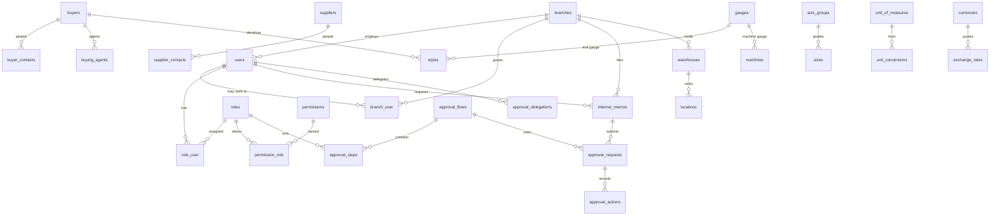

# Foundation ERD

Phase 1 covers the registers the rest of the factory hangs from. Later documents (orders, lots, bundles) will point at these rows.

`audits`, `attachments`, `notifications` and `issues` (later) attach to any of these by morph.

Traceability, once production exists: a buyer complaint points at a bundle, the bundle points at a knitting job, the job points at a yarn lot, the lot points at a supplier. The lot and the bundle are the two atoms. They are not tables yet.
